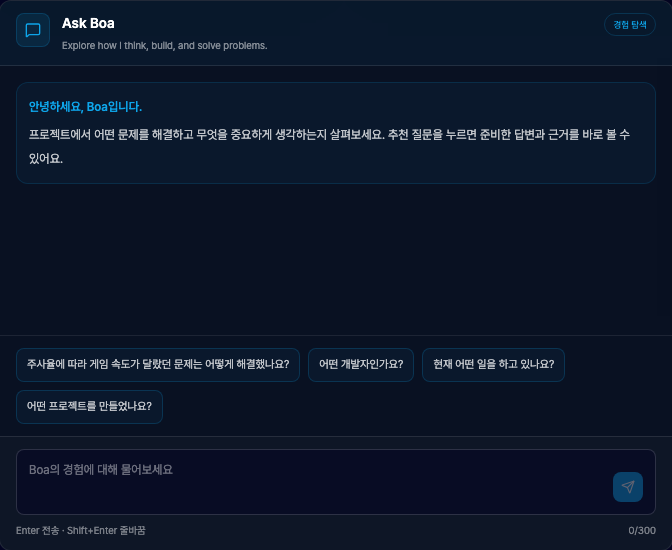
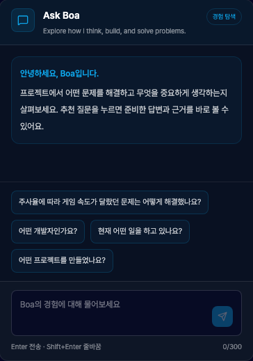
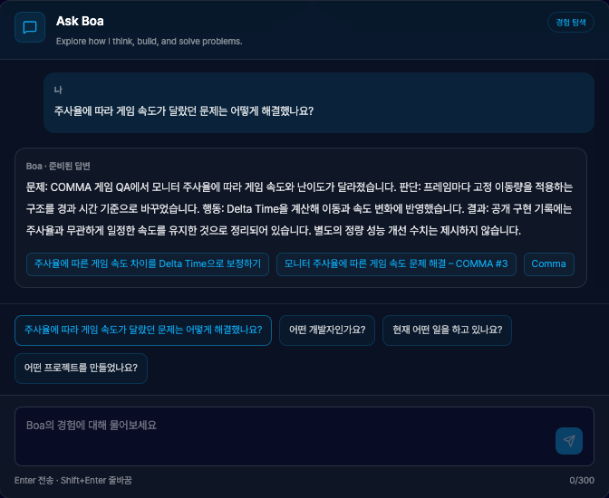
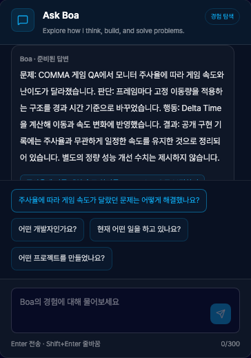

# PR 2 Ask Boa 정적 탐색

- 검증 코드: `febbc92a4d174c455bb3f7c3814f89a42eb76b8b`.
- 실제 공개 FAQ·COMMA 사례 사용. 추천 질문·입력 모두 실제 API 요청 0건.
- Node 22.22.1 / pnpm 10.8.1 / Chromium. 콘텐츠·타입·린트·빌드·Jest 18개·브라우저 36개 통과.
- 초기 카드와 답변 카드, desktop 1440×900 / mobile 390×844, dark/light 테마.
- 모바일 긴 답변의 끝부터 보이던 상태는 실패를 재현하고 시작 지점으로 이동하도록 보정함.
- 화면 너비 전환 시 Chat DOM 한 개·대화 유지, IME 조합·Enter·Shift+Enter·입력 길이 검증.
- 기존 Terminal 화면: [PR 0 기준](../resume-verification-loop/desktop-dark.png).

| Desktop initial | Mobile initial |
| --- | --- |
|  |  |

| Desktop answer | Mobile answer |
| --- | --- |
|  |  |

라이트 테마는 같은 폴더의 light 이미지에서 확인합니다. 자유 질문의 서버 API는 다음 PR에서 연결하며 현재는 준비 안내와 사례 링크를 제공합니다.

리뷰 수정: 두 번째 질문의 답변이 실제 화면에 보이는지 실패를 재현하고, 사용자 전송 의도와 기존 메시지 열람을 구분해 스크롤을 보정했습니다. 전체 검증 18개 단위·컴포넌트 / 36개 브라우저 통과. [전체 Desktop](resume/desktop-dark.png) · [전체 Mobile](resume/mobile-dark.png).
