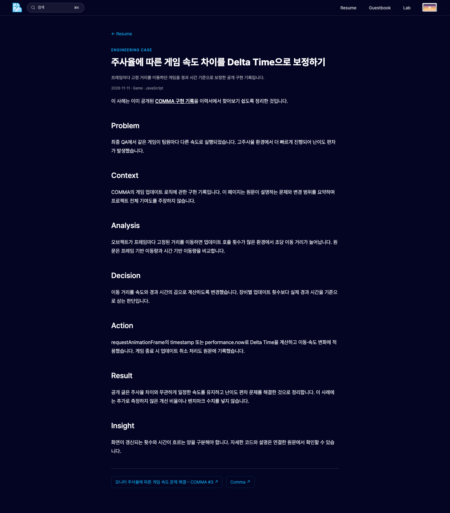
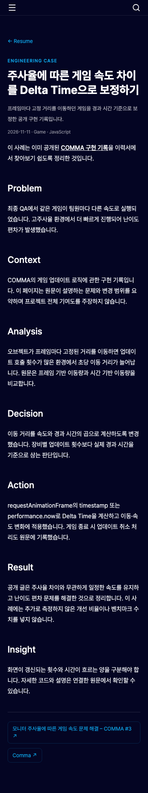
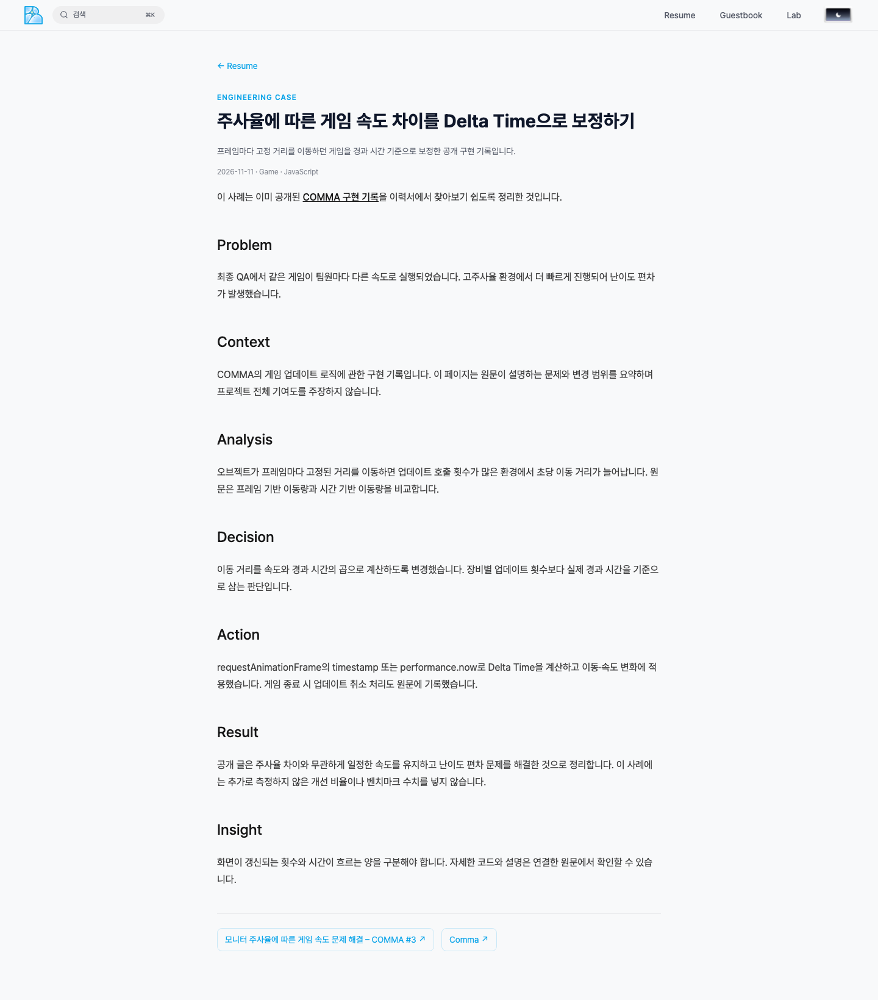
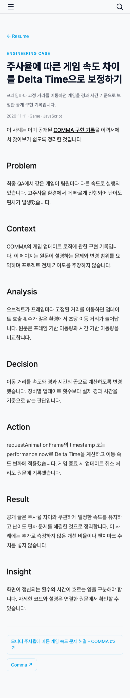

# PR 1 사례 상세 검증

- 검증 코드: `31ed7002a7854cf7157dc616a3c20b371518e407`.
- 기존 공개 COMMA 글을 요약한 실제 사례. Plaist/RoomE는 비공개 초안이며 직접 URL 404.
- Node 22.22.1 / pnpm 10.8.1 / Chromium / 로컬 프로덕션 빌드 / 실제 LLM 호출 없음.
- 콘텐츠·타입·린트·빌드·단위 14개 통과. 기존 Resume 브라우저 12개와 사례 브라우저 12개 통과.
- 브라우저 번들 36개에 비공개 초안 marker·실제 제목·본문이 없는 것을 검사함.
- Desktop 1440×900, Mobile 390×844, 라이트·다크 테마. 신규 페이지라 Before는 없음.

| Desktop | Mobile |
| --- | --- |
|  |  |
|  |  |

리뷰 후 외부 근거가 상세·FAQ·모델 문맥에서 유지되는 회귀 테스트를 추가하고 전체 검증을 재실행했습니다. 최종 브라우저 검증 24개가 모두 통과했습니다.
