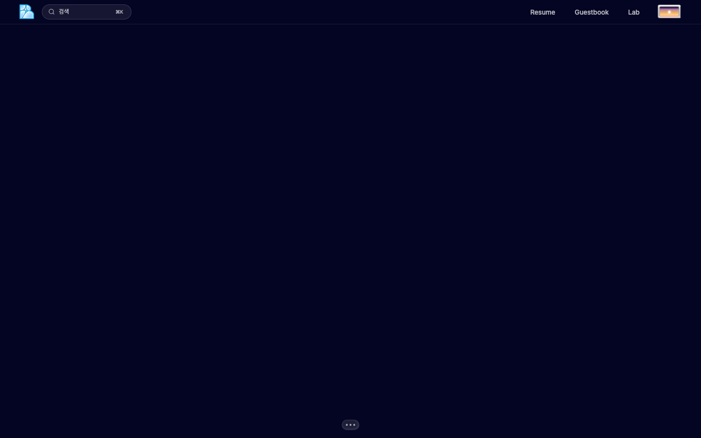
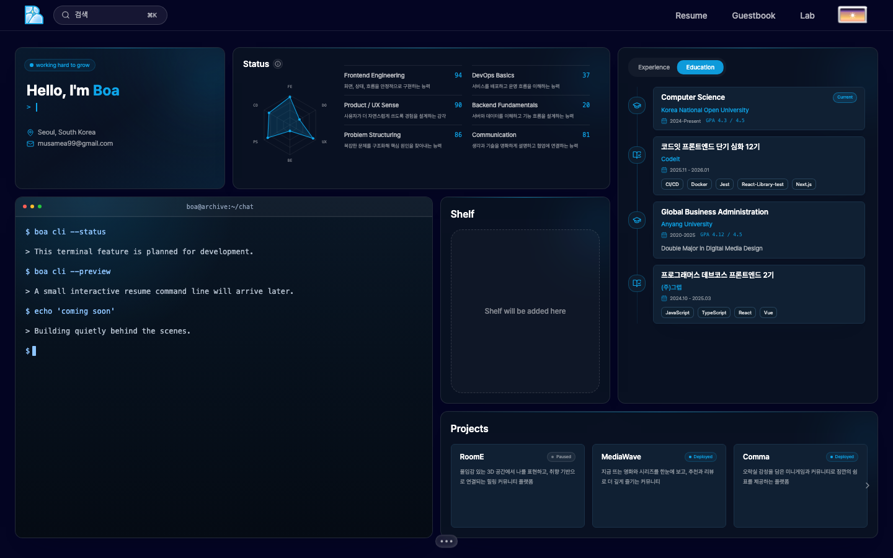
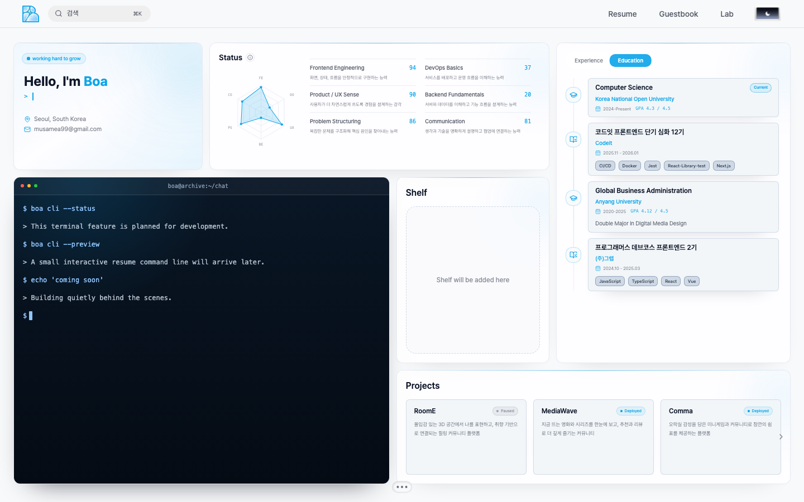
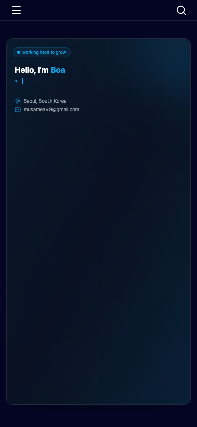
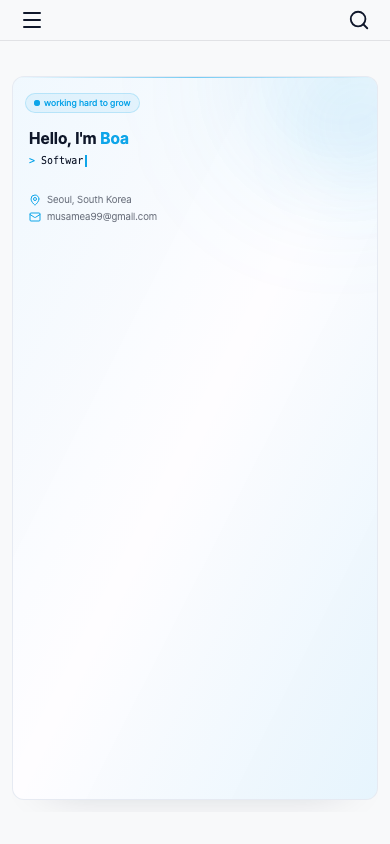

# PR 0 화면 검증 자료

- 검증 코드 커밋: `6fe6a0df38a9681f703110b94b8dc1c34cd01563`
- 기준 코드: `b6ff46f4469e610df92e5b6c2d940d2ae1fbafbf`
- 환경: Node 22.22.1, pnpm 10.8.1, Chromium, 로컬 프로덕션 빌드.
- 검증: 콘텐츠·타입·린트·Jest 3개·브라우저 12개 통과. 고정 lockfile 재설치 확인.
- 실제 공개 Resume 데이터 사용. Gemini/Chat API 호출이나 운영 DB 변경 없음.
- 모든 캡처는 OS의 동작 줄이기 설정을 사용. Desktop 1440×900, Mobile 390×844.
- Before는 기존 코드에서 불투명도 검증이 실패했을 때 남긴 실제 캡처다. After에서 카드와 텍스트가 보이는지 직접 확인했다.
- 모바일 카드가 각 화면 높이를 차지하는 기존 구성은 PR 2의 반응형 레이아웃 변경 대상이다.

| 상태 | 이미지 |
| --- | --- |
| Desktop Before — 카드 투명 |  |
| Desktop After — dark |  |
| Desktop After — light |  |
| Mobile After — dark |  |
| Mobile After — light |  |

보고서에는 태블릿과 프로젝트 영역 캡처도 포함한다. 전체 브라우저 자료는 CI artifact에서 확인한다.
